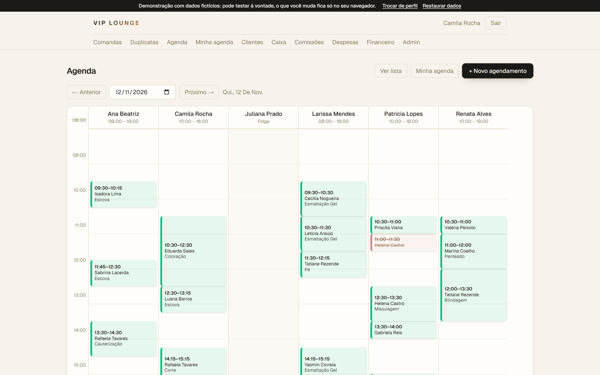
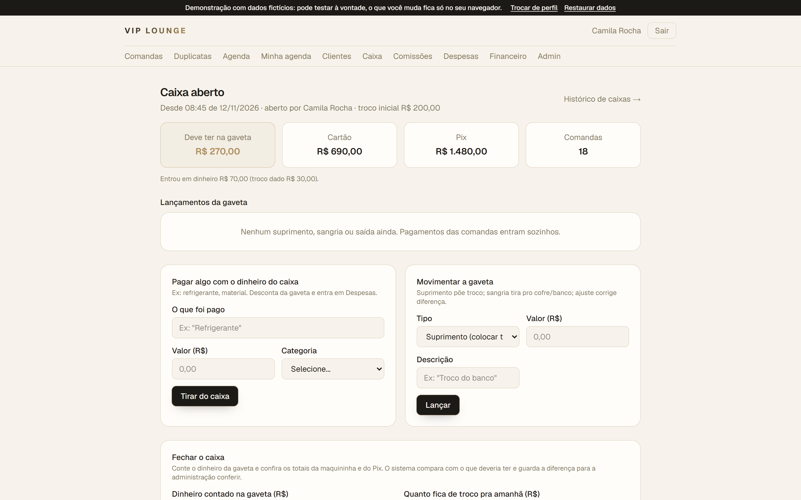
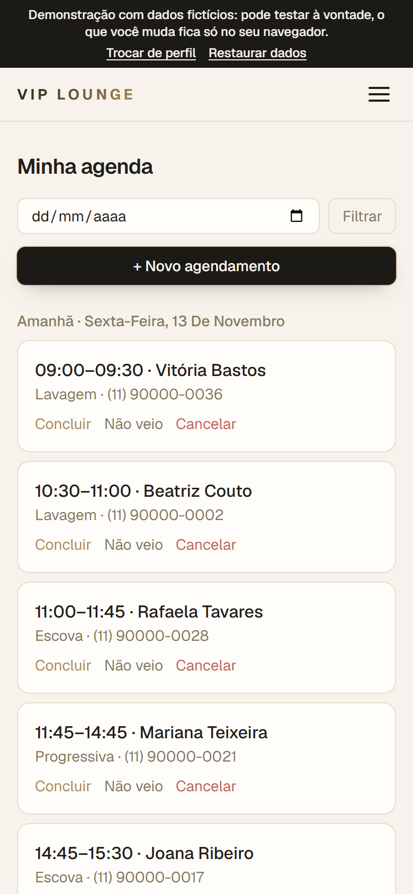
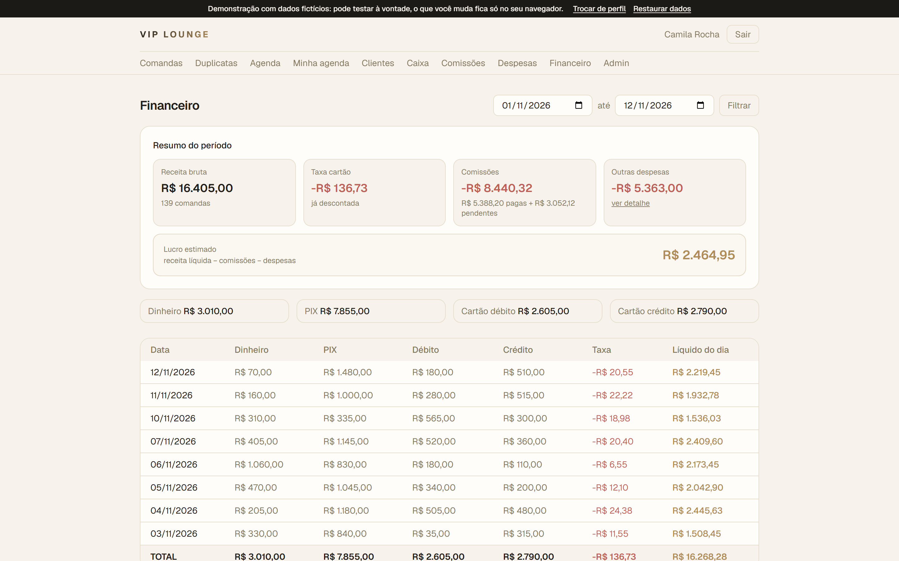
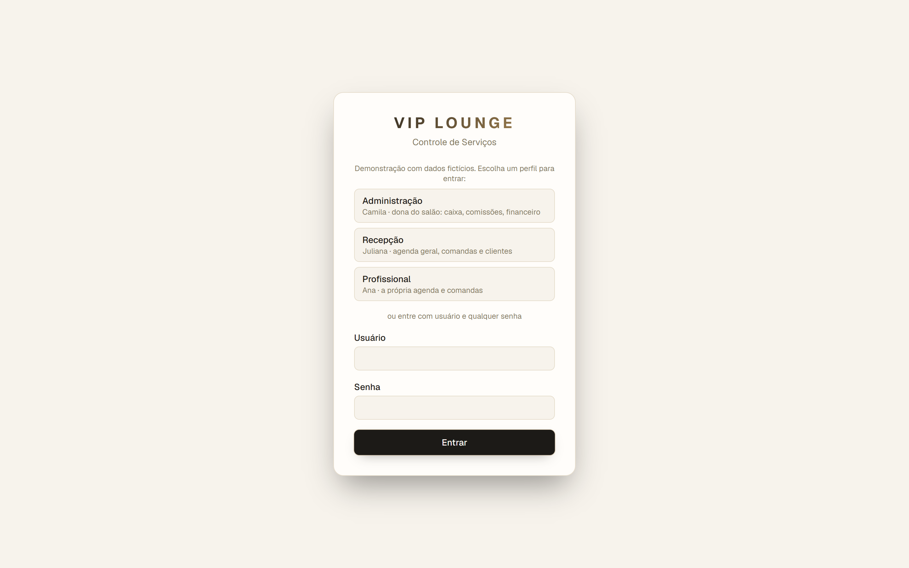
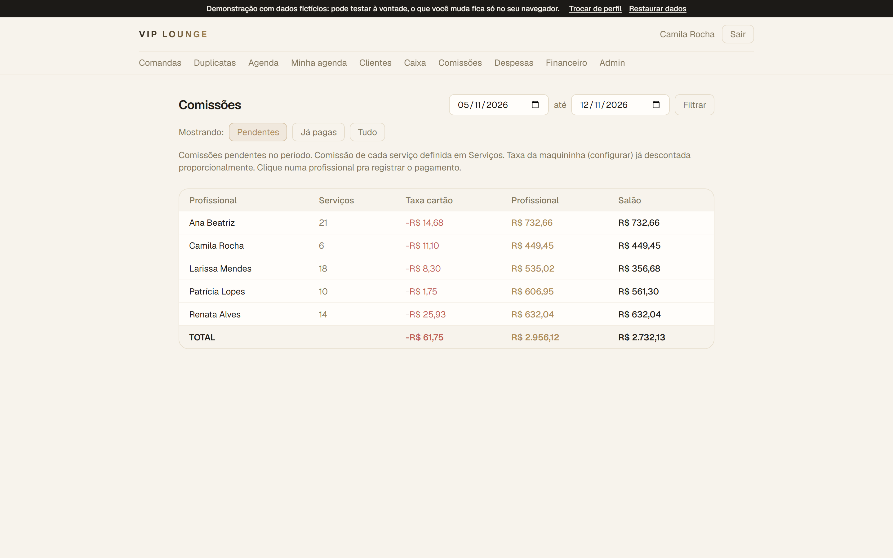

# VIP Lounge: gestão de salão de beleza

Sistema web usado no dia a dia de um salão de beleza: agenda das profissionais,
comandas com pagamento dividido, fiado (duplicatas), controle de caixa com
fechamento cego, comissões, despesas e financeiro. Funciona no computador da
recepção e no celular de cada profissional.

> **Esta é a versão de vitrine (portfólio).** O código é o do sistema em produção, mas
> roda com um **banco de dados falso e dados 100% fictícios**. Nenhuma cliente,
> profissional, telefone, valor ou chave real está neste repositório.

**▶ Demo online: [salao-vitrine.vercel.app](https://salao-vitrine.vercel.app)** · entre com um clique como Administração, Recepção ou Profissional



## O que o sistema faz

| Área | Funcionalidades |
|---|---|
| **Agenda** | Calendário por profissional com horário de trabalho por dia da semana, bloqueio de horário sobreposto, transferência entre profissionais, "minha agenda" no celular, concluir / não veio / cancelar |
| **Comandas** | Vários serviços e profissionais na mesma comanda, pagamento dividido (dinheiro com troco, Pix, débito, crédito parcelado), busca de cliente com sugestões |
| **Duplicatas** | Comanda paga em parte vira fiado; o restante é recebido depois, no caixa do dia em que o dinheiro entrou |
| **Caixa** | Abertura com fundo de troco (pede justificativa se não bate com o último fechamento), suprimento, sangria, ajuste, estorno, despesa paga com dinheiro da gaveta, fechamento cego e conferência pela administração; caixa fechado trava comandas e despesas |
| **Comissões** | Cálculo por serviço (parte do salão configurável), taxa da maquininha descontada proporcionalmente, proprietárias isentas, registro de pagamento que vira despesa |
| **Financeiro** | Receita por forma de pagamento, taxas de cartão, comissões pagas e pendentes, despesas por grupo e categoria, lucro estimado |
| **Clientes** | Histórico de visitas, total gasto, ticket médio e campanha de WhatsApp para clientes inativas |
| **Permissões** | Administração, recepção e profissional veem menus e dados diferentes |

<table>
  <tr>
    <td width="70%"></td>
    <td width="30%"></td>
  </tr>
  <tr>
    <td></td>
    <td></td>
  </tr>
</table>



## Stack

- **Next.js 16** (App Router, Server Components, Server Actions, `proxy.ts`), React 19, TypeScript
- **Tailwind CSS 4**
- **Supabase**: Postgres com RLS, Auth e regras de negócio no banco (triggers e funções `plpgsql`
  para caixa e travas, conflito de agenda com `exclude using gist`)
- **Deploy:** Vercel

## Como rodar

```bash
npm install
npm run dev     # http://localhost:3000
```

Sem variáveis de ambiente o app abre no **modo demonstração**. Para ligar num Supabase de
verdade, copie `.env.example` para `.env.local`, preencha e aplique as migrations de
`supabase/migrations/` em ordem.

## Como funciona o modo demonstração

As telas e as Server Actions são exatamente as da versão em produção. Só muda o cliente
do Supabase (`src/lib/supabase/server.ts`), que no modo demo vem de `src/lib/supabase/demo/`:

- **`engine.ts`**: um "Postgres de mentira" em memória. Entende `select` com relações
  (`profissional:profissional_id(nome)`, `comanda_itens(*)`, `!inner`), filtros, ordenação e
  `insert/update/upsert/delete` com cascata e restrições, e reimplementa em TypeScript as
  regras que no banco real são triggers e funções SQL (caixa, travas, conflito de horário,
  horário de trabalho), com as mesmas mensagens de erro.
- **`seed.ts`**: gera cerca de 45 dias de agenda, comandas, caixas fechados e conferidos,
  comissões pagas e despesas a partir da data de hoje.
- **`index.ts`**: guarda as alterações de cada visitante como um log de operações compactado
  em cookies `httpOnly`. O estado é "seed do dia + operações do visitante": cada pessoa testa
  sem ver o que as outras fizeram, sem banco nenhum, num deploy serverless comum.

## Estrutura

```
src/
  app/                  rotas (comandas, agendamentos, caixa, comissões, despesas, financeiro, admin)
  components/           formulários e componentes de tela
  lib/                  regras puras (taxas, permissões, datas, clientes)
  lib/supabase/         clientes do Supabase (servidor, admin) e o modo demonstração
  proxy.ts              proteção de rotas por sessão
supabase/migrations/    esquema, RLS, triggers e funções do caixa
```
